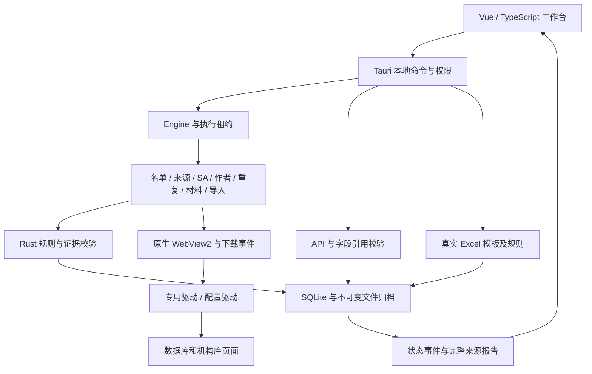

# 工作台架构 · 0.2.0

业务以 [PPT 整体逻辑](TAURI_REBUILD_GOAL.md) 为准，源码范围见 [0.2.0 实现核对](TAURI_COMPLETION_AUDIT_0_2_0.md)。本版本只编译打包，未运行测试或操作真实网站；历史模拟验证不算当前版本的运行验收。

## 一条贯穿全程的数据链

`名单原表 → SA 任务与论文身份 → 来源/原文件 → 分支核验 → 材料 → 平台执行 → 结果回读 → 来源报告`

SQLite 保存业务状态，Excel 用于输入输出。Vue 展示状态并发出受类型约束的本地命令；页面驱动观察实际控件和结果，不决定任务完成。同一论文原文件可以复用，各 SA 的责任人、核验和完成独立。

## 责任边界

以下路径相对 `desktop/`。

| 层             | 实现                                                                                                                                       |
| -------------- | ------------------------------------------------------------------------------------------------------------------------------------------ |
| 启动与命令     | `src-tauri/src/main.rs` 装配；`commands/` 验证本地主窗口、读取参数并取得执行租约                                                           |
| 唯一运行服务   | `src-tauri/src/engine.rs` 管理 Store、活动任务、窗口和事件                                                                                 |
| 名单/版本      | `core/src/files.rs`、`store.rs`、`versions.rs`；物理 A 列、负责人范围、原表归档和旧记录迁移                                                |
| PPT 分支与核验 | `core/src/model.rs`、`library.rs`、`sa.rs`、`issues.rs`，以及 `engine/` 对应服务                                                           |
| 作者/单位/合并 | `metadata.rs`、`metadata_order.rs`、`claim.rs`、`alias.rs`、`merge.rs`；原始身份、字段与回读                                               |
| WOS 下载       | `engine/downloads.rs`、`core/src/download.rs`、`wos_search.rs` 与共用 WOS 页面驱动                                                         |
| 原生来源浏览器 | `src-tauri/src/browser.rs`、`source_browser.rs`、`core/src/source_downloads.rs`；注册渠道会话、来源边界、Requested/Finished 回执、实际字节 |
| CNKI 专用获取  | `core/src/cnki.rs`、`commands/source_browsers.rs`、`browser/cnki-adapter.cjs`                                                              |
| 通用渠道获取   | `core/src/source_flows.rs`、`commands/source_flows.rs`、`browser/source-adapter.cjs`；完整结果、实际详情、配置步骤、未知导出和批量范围     |
| 来源解析与另存 | `source_files.rs`、`ris.rs`、`cnki_excel.rs`；完整原始记录、Excel/CSV/TXT/RIS 与转换回执                                                   |
| AI/模板/材料   | `src-tauri/src/ai.rs`、`classification.rs`、`templates.rs`、`template_rules.rs`、`materials.rs`、`material_batch.rs`                       |
| 平台提交       | `engine/submission_service.rs`、`engine/writes.rs`、`core/src/submission.rs`、`submission_bundle.rs`；冻结原材料、分阶段意图和实际批次回读 |
| 报告           | `core/src/files.rs::export_report_with_source_runs`；原输入、全来源、字段引用和所有队列历史                                                |
| 页面与类型     | `src/services/desktop.ts`、`types.ts`、`composables/useWorkbench.ts` 及业务组件                                                            |
| 能力注册       | `core/src/framework.rs`、`catalog.rs`、`workflow.rs` 和 `src-tauri/capabilities/`                                                          |

核心规则不依赖 Tauri 窗口。平台副作用统一通过持久原意图和回读处理，不另建第二套状态。

## 原始来源与派生资料

数据库原文件和平台接受格式是两份契约：来源可解析不代表可直接上传。RIS、网页字段和原始 JSON 响应保存完整依据，供 API AI 和模板整理；原格式提交必须证明文件、单篇选择、身份、来源、渠道与完整记录一致。

各渠道 Excel 另存沿用既有转换回执协议，保留原件、实际单元格、输入编码、内容哈希及 XLSX 字节哈希。重名表头按列位置区分；含无法完整保留的内容停止转换。任务绑定重新检查实际字节，不从文件名推断完成。

WOS TXT/CNKI 使用专用流程。其他渠道的共用驱动依据入口、允许域名、当前唯一可见控件和可保存的步骤运行。原始导出前保存检查点，执行租约交给原生下载接收器，完成事件再保存回执；弹出窗口须归属同一来源会话。

## 队列和恢复

WOS、来源、AI、材料各自保存原范围和结果，共用 Engine 并发约束。来源队列记录完整名单、顺序、渠道、页面流程、当前位置及全部历史；单篇普通失败继续，通道问题暂停。队列关闭自己建立的已完成窗口，不关闭用户原有窗口。

暂停请求与逐篇结果在事务中合并，避免结果保存覆盖暂停。重启将运行中范围标为中断，未确认的原导出标为未知，不自动重发。原生回执只可对应原会话、原任务和原范围；多份文件必须明确选择。

未知平台写入始终读取冻结的原操作载荷与原文件，不使用后来改变的 AI 建议、表单或材料选择替代。原批次跨已核对的名单版本保留；恢复确认不授权创建新的批次。

## 前端和远程权限

本地主窗口调用闭合的 TypeScript 命令集合。远程来源页仅有结果回传能力，回传绑定实际注册窗口、域名、命令令牌、到期时间和动作。页面不能读取 API 密钥、任意本地文件或直接修改设置。

成果类型、来源渠道和平台导入渠道分别表达。Scopus/其他来源通过实际平台模板整理，不声明不存在的机构库按钮。界面分别显示来源检索、原导出、文件解析、模板与提交能力，以及未现场验证的状态。

## 完成与验收

实现已接通当前规范的底层链路；运行时必须有实际来源、正确身份、真实控件、有效机构权限及完整结果回读。代码编译成功不能替代业务验收。

当前生产构建不执行测试或真实网站操作。测试用例保留在核心和仓库 `tests/` 中，是否执行由用户授权决定；本轮仅交付用于自测的安装包与可追溯源码。
