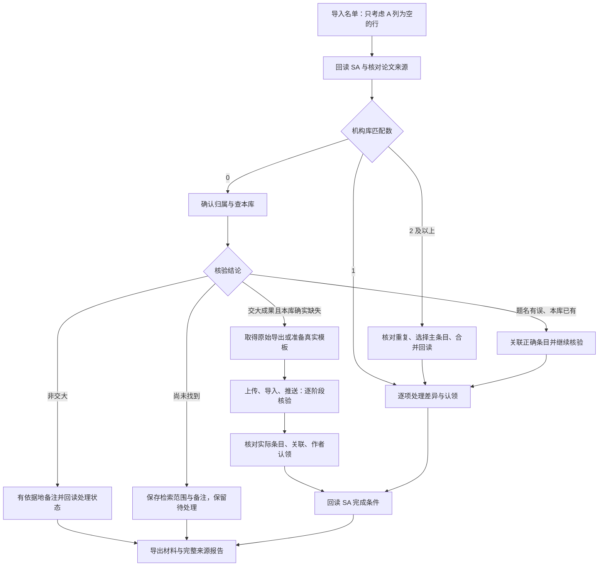

# 当前项目完整逻辑 · 0.2.2

更新：2026-10-12。依据当前源码及实际测试记录；业务源码提交为 `33c9fcfdc51156c4588e6929d9b836a25d7ce98e`。本文描述实际实现及边界，PPT 原规范见 `TAURI_REBUILD_GOAL.md`。

## 项目要完成什么

从 `list.xlsx` 读取待处理 SA 记录，核对论文来源、身份和上海交大归属，按机构库匹配数分流。需要补充的成果优先取得数据库原始导出；原始导出不可用时，根据有依据的 AI 建议填写实际平台模板。机构库各阶段执行、结果回读及最终 SA 状态分别保存，最后导出完整材料与来源报告。

## 1. 名单、任务和版本

- 只考虑 Excel 物理 A 列为空的行；文字、数字、布尔值等非空内容跳过。
- 读取负责人、SA ID、题名、DOI、WOS ID、工号、匹配数、平台条目 ID、标记及待处理原因。
- 缺少必需列、重复 SA ID 冲突或长编号数值精度不可靠时拒绝导入，保留问题供修正。
- 归档原表和内容哈希，保存实际行号及输入版本。任务由 SA ID 标识。
- 同一论文可以对应多个 SA 任务；核对后的来源文件可以复用，每个任务的负责人、认领和完成状态独立。
- 按负责人和可执行范围建立队列。执行前回读 SA 当前记录，名单或平台关键字段变化时先核对差异。
- 重导名单不会覆盖原提交意图、旧来源或已有批次；采用新版本需明确核对，旧队列不能绕过新名单范围。

## 2. 匹配数决定业务分支

| 匹配数 | 实际处理 |
| --- | --- |
| 0 | 先核对文献身份、交大归属及机构库是否已有。只有交大成果且本库确实缺失才准备新增导入。 |
| 1 | 回读现有条目，按每个待处理原因核对作者、单位、认领和 DOI/WOS 身份；必要时准备修改并回读结果。 |
| 2 及以上 | 取得重复候选及完整元数据，明确主条目和保留字段，合并回读，再继续其余 SA 原因核验。 |

零匹配有四个结论：非交大；题名等信息错误但本库已有；交大成果且本库缺失；尚未找到文献。非交大结论需要真实归属依据；题名错误使用正确来源题名查本库；本库缺失需核对实际查询范围。尚未找到保存查询词、时间、范围和备注，保持待处理。网络、登录、验证码、页面识别失败不属于论文无记录。

匹配一条时，每个原因独立保存结论。作者角色、作者与单位顺序、单位关联、认领和别名均需真实来源及准确的作者/工号身份；名字相似不足以证明身份。同一条目合并成功后仍要继续核对 SA，不能直接按合并动作认定任务完成。

## 3. 来源获取与下载

成果类型、资料来源渠道、平台提交渠道分开保存。例如“期刊论文”是成果类型，“CNKI”是来源/导入渠道，两者不是一一对应关系。

| 来源 | 当前实现 |
| --- | --- |
| WOS TXT | 专用检索与身份核验，核心合集、制表符 TXT、完整记录；原生下载事件、实际文件及哈希核对。 |
| CNKI | 专用篇名查询、完整结果与唯一精确题名核对、详情题录响应保存；内置浏览器原始导出与 Excel 另存。 |
| WOS Excel、CSCD、CSSCI、万方、EI、VIP、IncoPat | 共用来源浏览器和配置流程：实际入口、控件、结果范围、详情字段及原始导出步骤。 |
| Scopus、其他来源 | 共用来源、原件及 RIS 获取；通过实际平台模板整理，不声明不存在的专用机构库入口。 |
| DOI / Crossref | 按 DOI 取得登记元数据，保存完整原始响应，作为来源依据。 |

程序检查当前可见控件和实际文字；多页或同名不能凭第一页或首条记录自动选择。共用驱动未识别页面时需要保存该站的实际定位条件，并不等于每个数据库已经具备全部专用适配。

WebView2 是应用内置浏览器。登录资料按会话目录保留，验证码由用户完成。点击导出后，收到原生下载完成回执、核对实际文件及哈希，才记为下载成功。文件保存到工作目录的 `downloads/` 或 `downloads/sources/`。用户在外部 Chrome 下载的文件仍可能进入系统 Downloads，可通过本地文件选择接入。

原始文件保留全部字段和原字节。XLS/网页表格 XLS 另存 XLSX 时保留原件、单元格及转换回执；无法完整保留时停止转换。多篇文件需要明确选出对应记录，不能直接作为单篇提交材料。

## 4. AI 分类与模板填写

真实来源、名单中的题名/标识符、已有元数据和实际模板规则作为 API 输入。API 返回成果类型、渠道建议、分类理由、字段值、来源引用、置信度与缺项。

本地程序验证返回结构、来源引用、允许的类型和模板规则，保存完整响应及原输入版本。失败、截断或无有效引用的返回不会直接采纳。AI 只提供建议，不推进 SA 完成状态，也不直接操作数据库网页或机构库。

模板需来自实际平台，可注册四个既有模板及其他类型。程序按实际列、说明、必填要求、枚举和格式写入 Excel；缺少关键字段的输出保留为草稿。AI 不编造 DOI、页码、作者角色、署名或数据库收录状态。

数据库原始导出优先于模板。详情摘录、派生 RIS、API JSON 和 CNKI 会话题录响应可供整理填表，但不能冒充数据库原始上传文件。

## 5. 提交与平台闭环

准备提交包时冻结 SA ID、原名单、来源、文件字节哈希、成果类型、导入渠道、机构及说明。只有符合当前核验分支和材料要求的任务可以继续。

新增主路径：

`材料核对 → 上传回执 → 批次导入回读 → 推送回读 → 查实际平台条目 → 关联 → 作者认领 → SA 回读`

所属机构为上海交通大学，说明为 `SA补充-<sa_lzk表ID>`。WOS 推送按 PPT 核对五项：查重为是；唯一标识、出版信息和题名相似度的查重方式；重复元数据按优先级合并；不存在条目新增；本校成果为是。实际控件或语义不符合时停止核对。

上传成功只进入 Uploaded，批次导入核验进入 Imported，推送核验进入 Pushed。最终还需核对实际条目、相关认领及 SA 完成条件；草稿、点击成功或 AI 分类成功不能替代这些结果。

## 6. 暂停、失败和恢复

新增主路径有待处理、检索中、下载中、已下载、材料就绪、已上传、已导入、已推送、已认领及已完成等状态；另有待核验和结果未知。其他业务分支不需要经过全部新增阶段。

WOS、来源、AI、材料各队列记录原范围、顺序、当前位置及逐篇结果，执行由同一个 Engine 约束。单篇明确失败可以继续后续任务；登录、通道超时、524、断开和结果未知保留队列等待恢复。没有连续三次 WOS 失败停止的规则。

重启后先恢复本地状态。无法确认上传、导入、推送、合并、字段保存或认领是否成功时，只核对原操作和实际平台结果，不自动重发。原始文件和载荷冻结，后来的表单、AI 建议或材料选择不能替换它们。

0.2.2 将 CNKI 的“抱歉，暂无数据，请稍后重试”明确归为来源服务未正常返回结果。WOS 524 也保留为来源访问异常，两者均不能当作文献未收录。

## 7. 数据保存、界面和编译

- Vue 3 / TypeScript：展示名单、任务、来源、材料、AI、进度与可执行操作。
- Tauri / Rust：窗口、命令权限、API、队列及平台操作调度。
- Rust core：业务规则、身份与证据校验、文件/模板、恢复与 SQLite。
- WebView2 和页面驱动：观察页面、执行明确步骤、接收原生下载。
- SQLite：保存任务、版本、证据、队列、原操作意图、批次与回执。
- 文件目录：保存原名单、实际下载、来源响应、原件与转换文件、模板、单篇和批量材料。

网页返回观察结果，由 Rust 核验并决定状态变化；网页不能直接把任务置为完成。远程页面只能在注册窗口、域名和命令范围内回传结果，不能读取密钥或任意本地文件。

导出的 Excel 包含原输入行、SA ID、核验结论、分类、来源文件/网址、原始依据、AI 字段引用、材料缺项、队列历史、批次及失败原因。长来源按顺序分段保存，不静默截断。API 密钥保存在 Windows 系统凭据中，不导出到报告。

主分支的 GitHub Actions 编译 Vue/TypeScript、Rust 和 NSIS Windows 安装包，附完整源码提交、版本、实际大小和 SHA256。构建工作流本身不执行业务测试。根目录 Python 工具和旧扩展保留历史实现，新版运行入口为 `desktop/`，EXE 不依赖旧扩展。

## 8. 当前边界

0.2.2 已通过 267 项核心测试、22 个离线来源浏览器用例、2 项原生单元测试和前端类型检查；GitHub 安装包成功构建并完成字节与哈希核对。上一轮 0.2.1 的 21 个界面/驱动套件和 10 个原生业务/进程恢复套件通过，本轮没有全部重跑。模拟平台通过不等于真实平台通过。

真实 WOS 曾出现 524 和未加载表单，App CNKI 在验证码通过后仍返回临时重试提示。真实完整下载、后台写入至 SA 完成及全部渠道兼容性尚未全部验收；本轮没有对真实机构库写入。

CNKI 专用题录解析目前覆盖 EndNote `%0` 和 RefWorks `RT`；用户新提供的 `SrcDatabase-来源库`、`Title-题名` 等标准标签 TXT 尚未纳入这个专用解析器，只能走普通文本读取，不能宣称已完成自动字段识别。该文件在机构库端失败的原因仍需实际批次失败详情，不能仅由 App 的解析缺口断定机构库失败原因。
